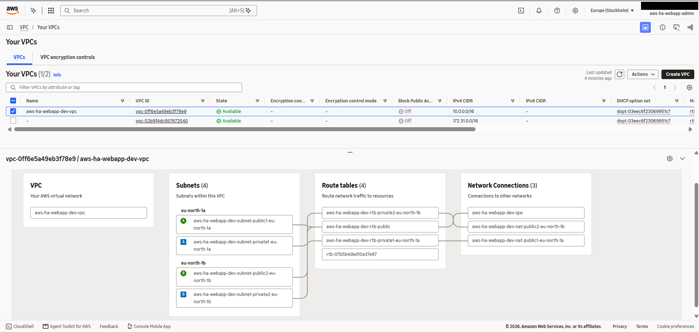
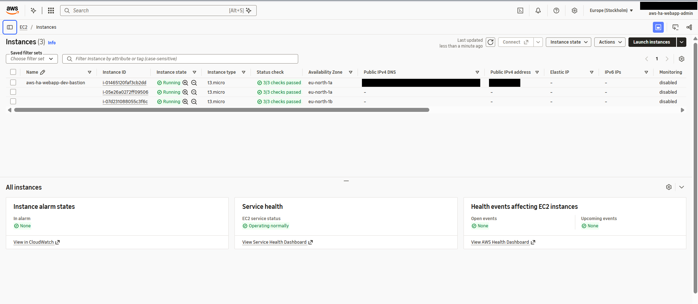
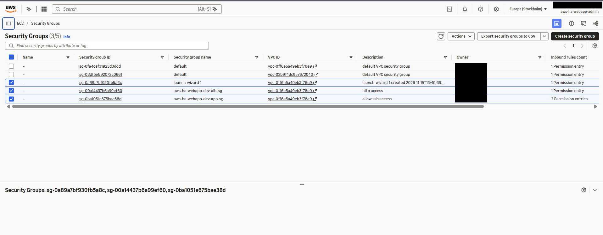
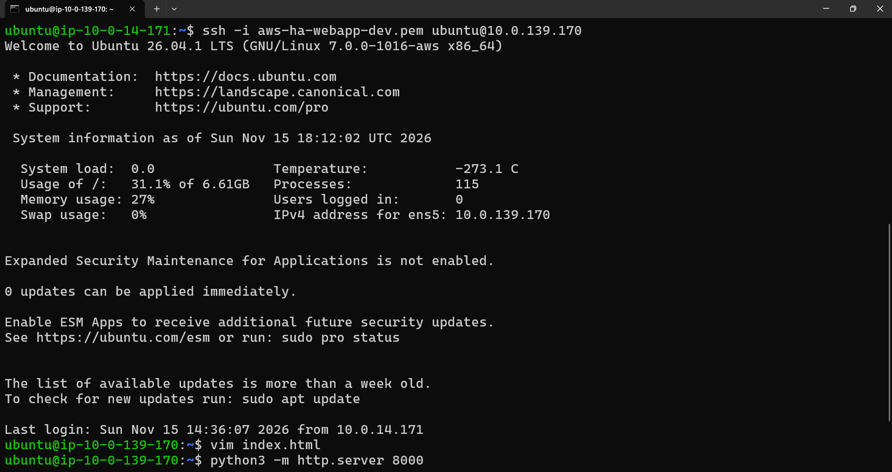
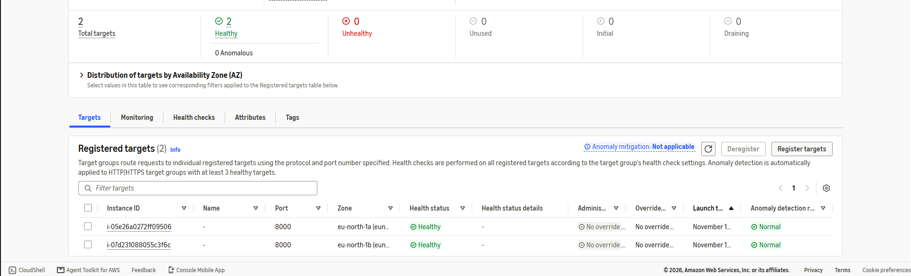
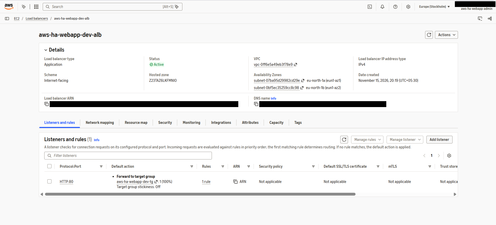
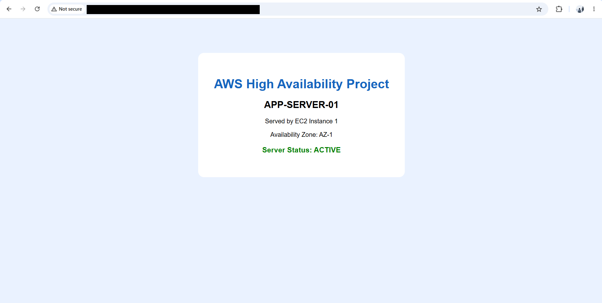
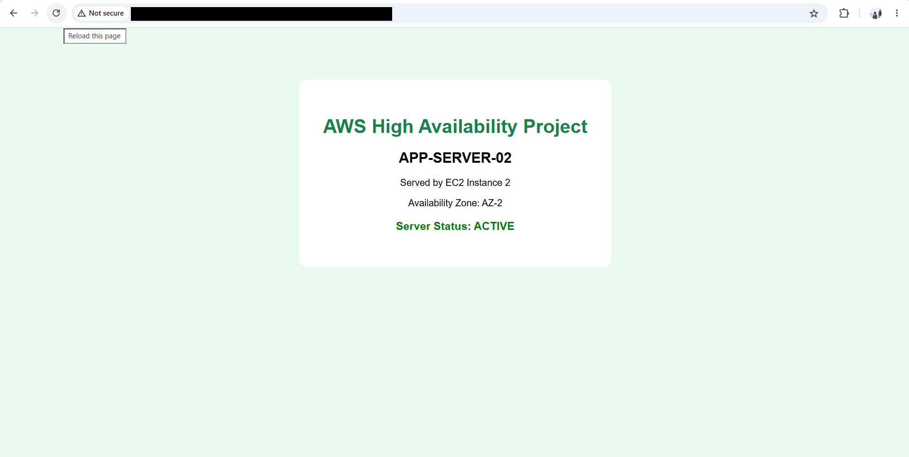

# aws-production-grade-web-application-deployment

Production-grade AWS infrastructure deployment using VPC, public and private subnets across multiple Availability Zones, EC2 Auto Scaling Group, Bastion Host, NAT Gateway, Application Load Balancer, and secure SSH access. Demonstrates high availability, network isolation, scalability, and load balancing.

---

## Table of contents

1. [Project overview](#project-overview)
2. [Services used](#services-used)
3. [Design decisions](#design-decisions)
4. [Network layout](#network-layout)
5. [Security group rules](#security-group-rules)
6. [IAM setup](#iam-setup)
7. [Demo application](#demo-application)
8. [Results](#results)
9. [Troubleshooting](#troubleshooting)
10. [Cost and cleanup](#cost-and-cleanup)
11. [What I learned](#what-i-learned)
12. [Next steps](#next-steps)

---

## Project overview

This project builds a two-AZ web application environment in `eu-north-1` (Europe, Stockholm) the way it would be set up for production:

- A custom VPC (`10.0.0.0/16`) with 2 public and 2 private subnets.
- Application servers run in the private subnets and have **no public IP address**.
- An internet-facing Application Load Balancer is the only public entry point for web traffic.
- An Auto Scaling Group keeps the desired number of instances running across both AZs.
- A bastion host in a public subnet is the only way to SSH into the private instances.
- One NAT Gateway per AZ gives the private instances outbound-only internet access (package updates).

A simple HTML page served on port 8000 is used as the demo application. Refreshing the load balancer URL alternates between the two instances, which proves load balancing works.

**Region:** `eu-north-1` (Stockholm)
**Resource prefix:** `aws-ha-webapp-dev`

---

## Services used

| Service | Purpose in this project |
|---|---|
| VPC | Isolated network (`10.0.0.0/16`) |
| Subnets | 2 public + 2 private, across 2 AZs |
| Route tables | Public route to IGW, private routes to NAT |
| Internet Gateway | Internet access for public subnets |
| NAT Gateway + Elastic IP | Outbound-only internet for private instances (one per AZ) |
| EC2 | Application servers and bastion host |
| Launch Template | Defines AMI, instance type, key pair, security group, user data |
| Auto Scaling Group | Keeps instances running across both private subnets |
| Target Group | Registers instances, runs health checks on port 8000 |
| Application Load Balancer | Public entry point, forwards HTTP 80 to port 8000 |
| Security Groups | Controls traffic between the internet, ALB, bastion and instances |
| IAM | Dedicated user and group with scoped permissions (no root usage) |

---

## Design decisions

| Decision | Reason |
|---|---|
| App servers in private subnets with no public IP | They cannot be reached directly from the internet, which shrinks the attack surface. |
| NAT Gateway in each AZ | Private instances can download updates without being exposed. One per AZ avoids a single point of failure. |
| Bastion host as the only SSH entry point | One controlled door for administration. SSH is allowed only from my IP. |
| Port 22 never open to `0.0.0.0/0` | Open SSH is one of the most common causes of compromised instances. |
| Instance SG allows port 8000 only from the ALB security group | Only traffic that came through the load balancer can reach the app. Referencing a security group is safer than using IP ranges. |
| Two Availability Zones | The app keeps running if one AZ has a problem. |
| Auto Scaling Group with min 2 / max 4 | Instances are replaced automatically if one fails. |
| Dedicated IAM user and group instead of root | Follows least privilege and keeps the root account for emergencies. |

---

## Network layout

| Item | Value |
|---|---|
| VPC name | `aws-ha-webapp-dev-vpc` |
| VPC CIDR | `10.0.0.0/16` |
| Region | `eu-north-1` |
| Availability Zones | `eu-north-1a`, `eu-north-1b` |
| Public subnets | `aws-ha-webapp-dev-subnet-public1-eu-north-1a`, `aws-ha-webapp-dev-subnet-public2-eu-north-1b` |
| Private subnets | `aws-ha-webapp-dev-subnet-private1-eu-north-1a`, `aws-ha-webapp-dev-subnet-private2-eu-north-1b` |
| Internet Gateway | `aws-ha-webapp-dev-igw` |
| NAT Gateways | `aws-ha-webapp-dev-nat-public1-eu-north-1a`, `aws-ha-webapp-dev-nat-public2-eu-north-1b` |

### Route tables

| Route table | Associated subnets | Default route (`0.0.0.0/0`) |
|---|---|---|
| `aws-ha-webapp-dev-rtb-public` | Both public subnets | Internet Gateway |
| `aws-ha-webapp-dev-rtb-private1-eu-north-1a` | Private subnet 1 | NAT Gateway in `eu-north-1a` |
| `aws-ha-webapp-dev-rtb-private2-eu-north-1b` | Private subnet 2 | NAT Gateway in `eu-north-1b` |

The VPC also contains the default main route table, which is not used by any of the project subnets.

---

## Security group rules

### `aws-ha-webapp-dev-alb-sg` (Application Load Balancer)

| Direction | Type | Port | Source / Destination | Purpose |
|---|---|---|---|---|
| Inbound | HTTP | 80 | `0.0.0.0/0` | Public web traffic |
| Outbound | All | All | `0.0.0.0/0` | Forward to targets |

### `launch-wizard-1` (Bastion host)

Created automatically by the EC2 launch wizard when the bastion was launched.

| Direction | Type | Port | Source / Destination | Purpose |
|---|---|---|---|---|
| Inbound | SSH | 22 | My IP only (`x.x.x.x/32`) | Admin access |
| Outbound | All | All | `0.0.0.0/0` | Reach private instances |

### `aws-ha-webapp-dev-app-sg` (application servers)

| Direction | Type | Port | Source / Destination | Purpose |
|---|---|---|---|---|
| Inbound | Custom TCP | 8000 | `aws-ha-webapp-dev-alb-sg` | App traffic only from the load balancer |
| Inbound | SSH | 22 | `launch-wizard-1` (bastion security group) | Admin access only through the bastion |
| Outbound | All | All | `0.0.0.0/0` | Updates via NAT Gateway |

---

## IAM setup

The project was built with a dedicated IAM user instead of the root account.

| Item | Value |
|---|---|
| IAM user | `aws-ha-webapp-admin` |
| IAM group | `grp-aws-ha-webapp-project` |
| Permissions | Granted through the group, not attached to the user directly |

See [`iam/group-policies.md`](iam/group-policies.md) for the full list of policies and why each one was needed.

Notes:
- The managed `FullAccess` policies are acceptable for a lab. In production I would scope them down to specific resources and actions.
- MFA is enabled on the root account and the IAM user.

---

## Demo application

Two small HTML pages, one per server, so the load balancer's behaviour is visible in the browser. Each page shows which instance answered. Each instance serves its page with `python3 -m http.server 8000`.

- [`app/index-instance1.html`](app/index-instance1.html)
- [`app/index-instance2.html`](app/index-instance2.html)

---

## Results

### VPC resource map

Two AZs, two public and two private subnets, one Internet Gateway, and one NAT Gateway per AZ with its own private route table.

### Private instances have no public IP

The two application servers (one per AZ) show no public IPv4 address. Only the bastion host has one.

### Security groups

The three project security groups: the load balancer group, the application group, and the bastion group.

### SSH through the bastion

Connected from the bastion host (`ip-10-0-14-171`) to a private application server at `10.0.139.170`.

### Target group with two healthy targets

Both registered instances (one per AZ) pass health checks on port 8000.

### Application Load Balancer

The load balancer is internet-facing and active across both AZs. Its HTTP:80 listener forwards 100% of traffic to the target group.

### Load balancing in action

| First request | After refresh |
|---|---|
|  |  |

Refreshing the load balancer URL alternates between the two instances.

---

## Troubleshooting

Problems I hit while building this, with causes and fixes, are documented in [`troubleshooting.md`](troubleshooting.md). Highlights:

| Problem | Cause | Fix |
|---|---|---|
| IAM user could not enable MFA | The group policies did not allow `iam:EnableMFADevice` | Assigned MFA from root |
| VPC creation failed with an Elastic IP limit error | Unused Elastic IPs from earlier labs counted toward the limit | Released the unused addresses and re-ran the wizard |

---

## Cost and cleanup

NAT Gateways and the Application Load Balancer are billed per hour, and Elastic IPs can incur charges when unattached. I deleted all resources after testing, in this order: Auto Scaling Group, bastion host, load balancer, target group, NAT Gateways, Elastic IPs, VPC, launch template, and leftover security groups.

---

## What I learned

- How to design a multi-AZ VPC with public and private subnets and separate routing for each.
- Why private instances need a NAT Gateway, and why one per AZ matters for availability.
- How to reach private instances through a bastion host. For this lab I copied the key to the bastion; in production I would use SSH agent forwarding (`ssh -A`), ProxyJump, or Session Manager so the private key never sits on the bastion.
- How security group referencing (ALB group to instance group) is safer than IP-based rules.
- How target group health checks decide whether the load balancer sends traffic to an instance.
- How to read IAM authorization errors and fix them with scoped policies.

---

## Next steps

- Rebuild the same environment with CloudFormation (and later Terraform) so it can be created with one command.
- Add HTTPS to the load balancer with an ACM certificate.
- Add a scaling policy and CloudWatch alarms to the Auto Scaling Group.
- Replace the bastion host with AWS Systems Manager Session Manager and remove SSH access completely.
